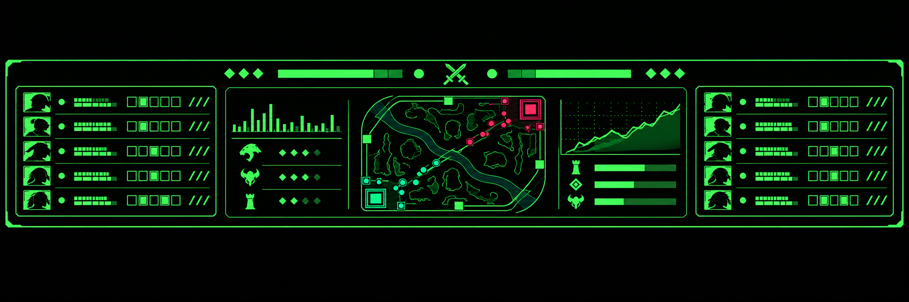

# tui-lol

[](https://github.com/jseramn/LOL-TUI/actions/workflows/ci.yml)
[](https://github.com/jseramn/LOL-TUI/releases/latest)

A terminal dashboard for a **live League of Legends match**, powered by the Live Client Data API. It shows the score, your lane and gold, a compact roster, key events, and short contextual guidance. The interface labels remain in Spanish.

## Get started on Windows

Install [Rust](https://rustup.rs/) and clone this repository. Enter a match before starting the live dashboard. The Live Client API is available during the match, not in the lobby or champion select.

```powershell
git clone https://github.com/jseramn/LOL-TUI.git
cd LOL-TUI
powershell -ExecutionPolicy Bypass -File scripts\run-live.ps1
```

The launcher locates the repository, prepares the Windows GNU toolchain, and runs Cargo with one job to reduce memory pressure. If no match is active, it explains the problem and starts the offline demo. Exit with **q** or **Esc**. Use `-Pull` to update before starting, `-Replay` for the demo, or `-LiveOnly` to stop when no match is available.

The project targets `x86_64-pc-windows-gnu`. If Cargo cannot find `dlltool.exe`, set `W64DEVKIT_HOME` to your w64devkit directory or add its `bin` directory to PATH. The launcher respects `CARGO_HOME` and `RUSTUP_HOME`; by default, they resolve under your user profile.

### Prebuilt Windows executable

Download `tui-lol.exe` from the [latest release](https://github.com/jseramn/LOL-TUI/releases/latest), place it in the repository directory, and run `.\tui-lol.exe` during a match. For a demo without the game, run `.\tui-lol.exe replay tests\fixtures\allgamedata\full.json`. The [CI workflow](https://github.com/jseramn/LOL-TUI/actions/workflows/ci.yml) also publishes a build artifact for each successful run.

## Offline demo and inspection

```powershell
cargo run -j 1 -- replay tests/fixtures/allgamedata/full.json
cargo run -- dump tests/fixtures/allgamedata/full.json
cargo run --example dump_frame
cargo run -- --help
```

`replay` opens the dashboard. `dump` prints a text snapshot. The `dump_frame` example writes UTF-8 frames under `docs/frames/` using Ratatui's test backend. See the [80×24](docs/frames/live-80x24.txt) and [120×32](docs/frames/live-120x32.txt) examples.

## Check match identity

```powershell
curl.exe -k https://127.0.0.1:2999/liveclientdata/gamestats
python scripts/live_bridge.py --id-only
```

The Live Client endpoint provides the match clock, mode and map. The numeric match ID may be absent there; the bridge reads it from the Riot client on Windows when available. The live dashboard shows your gold only in your own row.

## Optional remote connection

A remote coding harness can read match data through a temporary tunnel. The game's Live Client endpoint at `https://127.0.0.1:2999` exists only during a match and uses a Riot certificate. Expose the local HTTP bridge at `127.0.0.1:18789`, then tunnel **that bridge**. Never expose the Riot League Client Update API directly.

```powershell
powershell -ExecutionPolicy Bypass -File scripts\live-id.ps1 -Tunnel
# Or run the bridge and tunnel separately:
cargo run -- bridge
cloudflared tunnel --url http://127.0.0.1:18789
```

The command prints a `TUI_LOL_LIVE_URL` for the remote harness. `cloudflared tunnel --url` creates a temporary `trycloudflare.com` URL. For access limited to your tailnet, use `tailscale serve --bg 18789`. Use `tailscale funnel 18789` when you need a public URL. The remote client can pass `--live-url https://<tunnel-host>` or set `TUI_LOL_LIVE_URL`.

For a full manual check, see [manual verification](docs/manual-verify.md).
